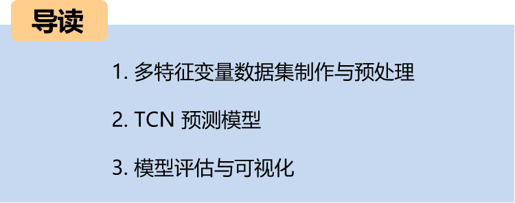
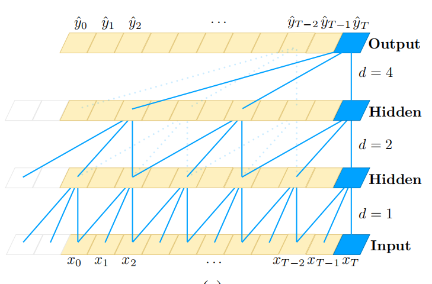
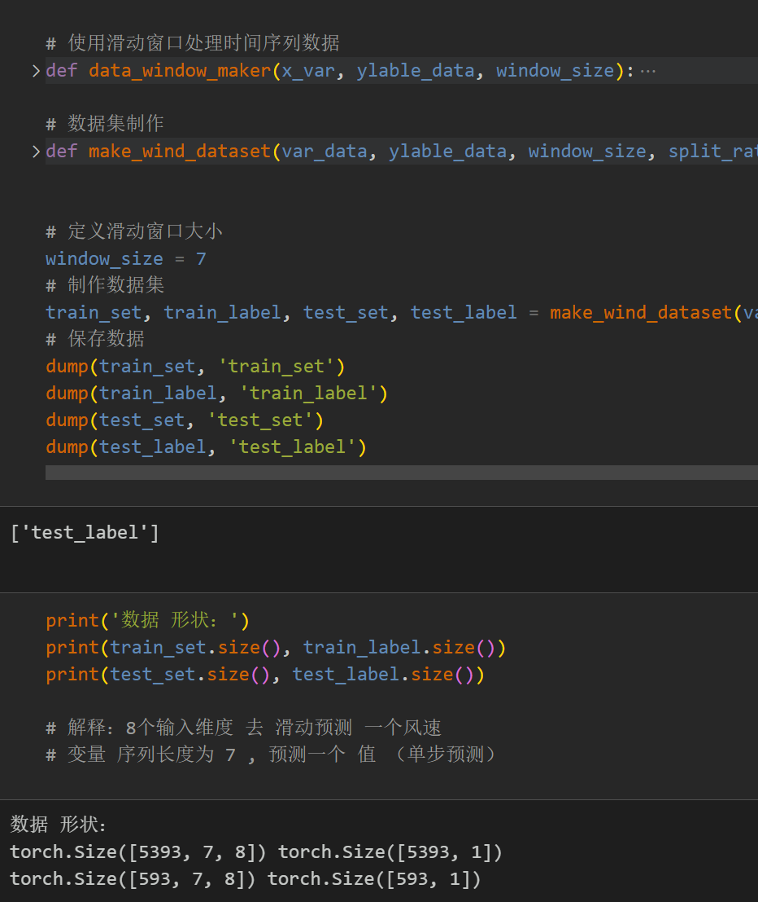
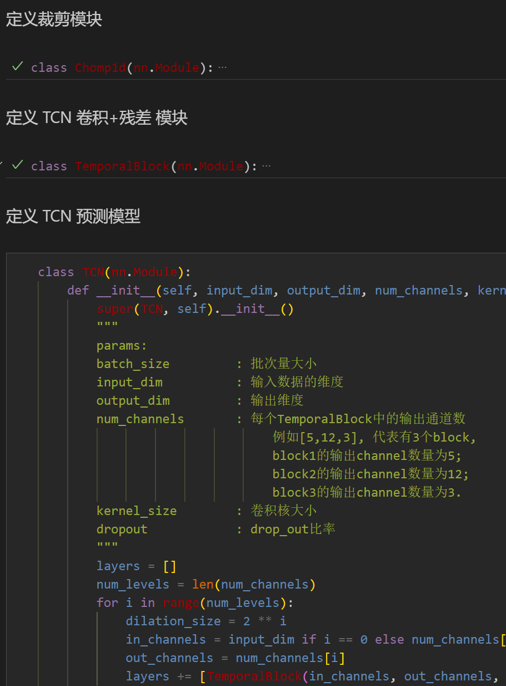
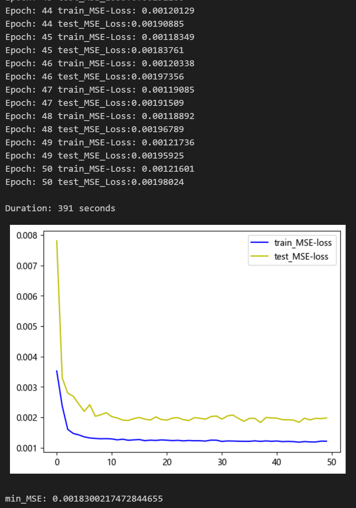
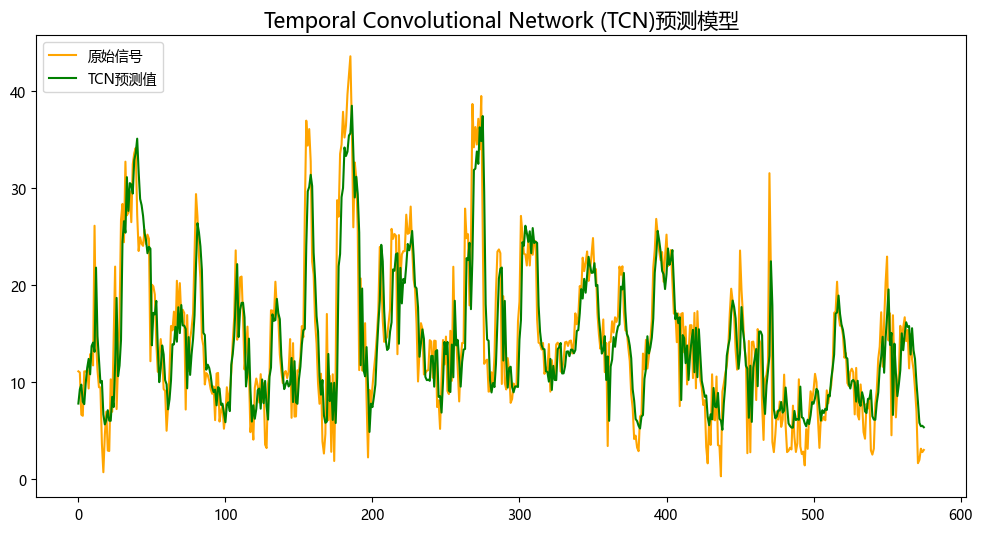
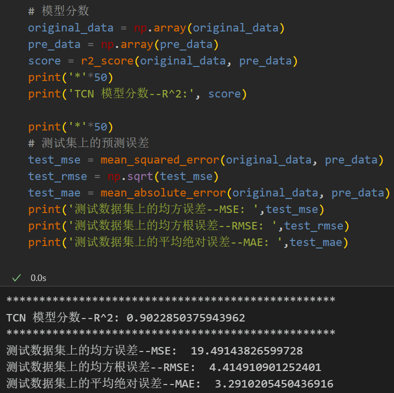
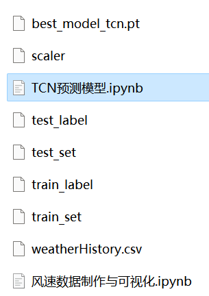

# Multi-feature variable sequence TCN prediction

Single-variable includes the following content:
Including wind speed data, as well as a pre-generated dataset and label set for wind speed, all of which can be run.
TCN prediction model, with smaller MSE and MAE, showing significant improvement in performance!
Includes code for data preprocessing and complete TCN model prediction and visualization code.
Preface:
This article introduces a multi-feature variable sequence prediction model based on the TCN network model, based on the previously introduced wind speed data (attached at the end to the dataset), to improve the predictive performance of time series data.
The overall structure of the model: The dataset consists of nine variables including weather, temperature, humidity, pressure, and wind speed. A sliding window is used to create the dataset, and multiple variables are used to predict wind speed. After extracting features through the TCN prediction model, it is then fed into a fully connected layer to achieve a high-precision prediction model.
Detailed introduction to the wind speed dataset can be found in the following text:
Wind Speed Prediction (Part 1) Dataset Introduction and Preprocessing
1 Multi-feature variable dataset creation and preprocessing
1.1 Importing data
1.2 Dataset creation and preprocessing
Firstly, divide the dataset, splitting it into training set and test set at a ratio of 9:1, creating the dataset.
2 Based on Pytorch's TCN prediction model
2.1 Defining the TCN prediction model
Note: The shape of the input wind speed data is [32, 7, 8], batch_size=32, where 7 represents the length of the sequence (the value taken from the sliding window), and the dimension of 8 represents the dimensions of the selected 8 variables.
2.2 Setting parameters and training the model
50 epochs, MSE is 0.00183, the multi-variable feature TCN prediction effect is good, and the performance is excellent. If appropriate adjustments are made to the model parameters, the performance of the model can be further improved.
Note: Adjust parameters accordingly:
- It may be appropriate to increase the number of TCN layers and the dimensionality of the hidden layer, adjusting the learning rate slightly.
\tIncrease more epochs (note to prevent overfitting)
\tThe sliding window length can be changed (set the appropriate window length).
3. Model Evaluation and Visualization
3.1 Results Visualization
3.2 Model Evaluation
Previously Featured Content:
Time Series Forecasting: Analysis and comparison of LSTM, ARIMA, Holt-Winters, SARIMA models
Wind Speed Prediction (Part 1) Data Set Introduction and Preprocessing
Wind Speed Prediction (II) EMD-LSTM Model Based on Pytorch
Wind Speed Prediction (III) EMD-LSTM-Attention Model
Wind Speed Prediction (IV) EMD-Transformer Model Based on Pytorch
Wind Speed Prediction (5) EMD-CNN-LSTM Model Based on Pytorch
Wind Speed Prediction (VI) - EMD-CNN-GRU Parallel Model Based on Pytorch
Wind Speed Prediction (7) VMD-CNN-BiLSTM Predictive Model
CEEMDAN + Combination Forecasting Model (BiLSTM-Attention + ARIMA)
CEEMDAN + Combination Forecasting Model (CNN-LSTM + ARIMA)
CEEMDAN + Combination Forecasting Model (Transformer - BiLSTM + ARIMA)
CEEMDAN + Combination Forecasting Model (CNN-Transformer + ARIMA)
Multi-feature Variable Sequence Prediction (I) - CNN-LSTM Wind Speed Prediction Model
Multi-feature Variable Sequence Prediction (II) - CNN-LSTM-Attention Wind Speed Prediction Model
Multi-feature Variable Sequence Prediction (III) - CNN-Transformer Wind Speed Prediction Model
Multi-feature Variable Sequence Prediction (IV) - Transformer-BiLSTM Wind Speed Prediction Model
Multi-feature variable sequence prediction (5) CEEMDAN+CNN-LSTM wind speed prediction model
Multi-feature variable sequence prediction (6) CEEMDAN+CNN-Transformer wind speed prediction model
Prediction model based on the SSA optimized by the sparrow optimization algorithm: CEEMDAN-BiLSTM-Attention
Prediction model based on the SSA optimized by the SSA optimized by the sparrow optimization algorithm: CEEMDAN-Transformer-BiGRU
Superior predictive model: Secondary decomposition-combined prediction
Multi-feature variable sequence prediction (7) CEEMDAN+Transformer-BiLSTM prediction model
Multi-feature variable sequence prediction (8) Prediction model based on the SSA optimized by the sparrow optimization algorithm: CEEMDAN-SSA-BiLSTM
Multi-feature variable sequence prediction (9) Prediction model based on the SSA optimized by the sparrow optimization algorithm: CEEMDAN-SSA-BiGRU-Attention
Multi-feature variable sequence prediction (10) Prediction model based on the SSA optimized by the sparrow optimization algorithm: CEEMDAN-SSA-Transformer-BiLSTM
VMD + CEEMDAN secondary decomposition, BiLSTM-Attention prediction model

## Images

<!-- PAYMENT_BLOCK -->

## Get this dataset

- Payment link (Stripe): [Buy now](https://buy.stripe.com/3cs8yP7sY87d0vu9AB)
- Payment QR code: 

<!-- /PAYMENT_BLOCK -->
